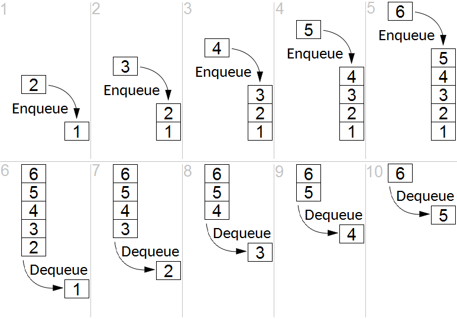

## What’s a queue

Instead of doing something in a single program on a single machine, you store a record that it should be done, stick that record in a separate system, and some other program does it later.

It’s like Kanban for computers.

---

## What’s in a queue?

```{=html}
<svg class="queue-diagram" viewBox="0 0 640 370" xmlns="http://www.w3.org/2000/svg" font-family="sans-serif" role="img" aria-label="An Application, a Redis box holding a stack of tasks, a stack of Workers, and a DB, connected by arrows from Redis to the Application, from Redis to the Workers, and from the Workers to the DB">
  <defs>
    <marker id="queue-arrow" viewBox="0 0 10 10" refX="9" refY="5" markerWidth="7" markerHeight="7" orient="auto-start-reverse">
      <path d="M0,0 L10,5 L0,10 z" fill="#dddddd"/>
    </marker>
  </defs>
  <g stroke="#222222" stroke-width="1.5" fill="#eeeeee">
    <rect x="418" y="12" width="203" height="156"/>
    <rect x="17" y="62" width="203" height="97"/>
    <path d="M28,270 A63,12 0 0 1 154,270 L154,329 A63,12 0 0 1 28,329 Z"/>
    <path d="M28,270 A63,12 0 0 0 154,270" fill="none"/>
  </g>
  <g fill="#222222" font-size="18" text-anchor="middle" dominant-baseline="central">
    <text x="519" y="26">Redis</text>
    <text x="118" y="110">Application</text>
    <text x="91" y="306">DB</text>
  </g>
  <g stroke="#222222" stroke-width="1.2" fill="#eeeeee">
    <rect x="441" y="51" width="37" height="23"/>
    <rect x="457" y="67" width="37" height="23"/>
    <rect x="473" y="83" width="37" height="23"/>
    <rect x="489" y="99" width="37" height="23"/>
    <rect x="505" y="115" width="37" height="23"/>
    <rect x="521" y="131" width="37" height="23"/>
  </g>
  <g fill="#222222" font-size="11" text-anchor="middle" dominant-baseline="central">
    <text x="459.5" y="62.5">task</text>
    <text x="475.5" y="78.5">task</text>
    <text x="491.5" y="94.5">task</text>
    <text x="507.5" y="110.5">task</text>
    <text x="523.5" y="126.5">task</text>
    <text x="539.5" y="142.5">task</text>
  </g>
  <g stroke="#222222" stroke-width="1.2" fill="#eeeeee">
    <rect x="265" y="208" width="82" height="67"/>
    <rect x="281" y="224" width="82" height="67"/>
    <rect x="297" y="240" width="82" height="67"/>
    <rect x="313" y="256" width="82" height="67"/>
    <rect x="329" y="272" width="82" height="67"/>
    <rect x="345" y="288" width="82" height="67"/>
  </g>
  <g fill="#222222" font-size="14" text-anchor="middle" dominant-baseline="central">
    <text x="306" y="241.5">Worker</text>
    <text x="322" y="257.5">Worker</text>
    <text x="338" y="273.5">Worker</text>
    <text x="354" y="289.5">Worker</text>
    <text x="370" y="305.5">Worker</text>
    <text x="386" y="321.5">Worker</text>
  </g>
  <g stroke="#dddddd" stroke-width="2" marker-end="url(#queue-arrow)">
    <line x1="418" y1="90" x2="226" y2="112"/>
    <line x1="520" y1="168" x2="348" y2="241"/>
    <line x1="520" y1="168" x2="460" y2="353"/>
    <line x1="265" y1="241" x2="154" y2="300"/>
  </g>
</svg>
```

---

## Break it on down

To improve that we break it up into threeish pieces:

- **Producer**\
  Loops through the input list, *enqueues* a job to be done and the input needed to do it
- **Queue**\
  Holds each job and the input the worker needs to run it.
- **Worker(s)**\
  Pulls (*dequeues*) jobs from the queue, runs them, saves output, and tells the queue that that job is done.
- DB somewhere, prolly

::: {.notes}
State:

You can use Redis extensions to give jobs a state, so they can enter queue as pending, be marked as processing when a worker is doing its thing, then get marked completed when it’s finished.
:::

---

## Why? They let you… {.smaller}

- **Restart** (instance dies at row 899,999 of 1M? No problem.)
- **Delay** (send all the emails when the market closes)
- **Use resources more efficiently** (different size instances for different jobs)
- **Scale by parallelizing** (queue 1M jobs, run 100 workers, finish 100x faster)
- **Buffer jobs** (don’t block on slow job, queue it and proceed)
- **Prioritize**: bank transaction to the fast queue, send newsletter to slow queue)
- **Ensure things get done** (job still in queue? Not done)
- **Retry things** (job fails? Requeue)
- **Track exceptions, unrecoverable errors** (job fails 10x? Mark failed, move on)

::: {.notes}
Restart helps if either the producer or the workers crash: If you the producer crashes, just rerun it, and have it check the queue for duplicates as it does it’s job, and not queue anything already in there. It’s idempotent.

If a worker crashes, if it hasn’t finished the job, it’s still in the queue marked as ‘processing.’ When the whole queue is done if you have some jobs lying around marked as processing, you can figure out what happened and redo them. This also supports marking things as error and the like.
:::

---

## User-facing use cases

- Sending email
- Processing images and video
- Running models
- Messaging and subscriptions (pub/sub)

---

## The naive non-queuing implementation

```
// videos_table contains a million rows
// loop through the whole damn thing
// on one machine, until you’re done

for each video in videos_table

	/* Slow, memory-intensive processing job
	   done inline,one row at a time */
end
```

::: {.notes}
You have 100,000 videos to process.

Each takes five minutes.

That’s 2,000,000 minutes

If you start on Jan 1, it’ll finish on Dec 14th
:::

---

## The Producer

```
for each video in videos_table
    where resize_job_id is null:

    job = resize_system.queue_job(
        video_url = video.url,
        width     = video.target_width,
        height    = video.target_height
    )

    update video_table
        set resize_job_id = job.id
        where video_id = video.image_id
```

::: {.notes}
Let’s break that naive implementation into a queued system
:::

---

## The Queue

:::: {.columns}
::: {.column width="28%"}
Outside data store, most commonly FIFO. Managed Redis is good.
:::
::: {.column width="72%"}
{fig-alt="Ten numbered panels: in panels 1–5 items 2 through 6 are enqueued onto a stack starting with 1; in panels 6–10 items 1 through 5 are dequeued from the bottom in the same order"}

::: {.credit}
Thanks Wikipedia
:::
:::
::::

---

## Example: video processing

- The input DB table contains 100,000 videos, their URLs, and the dimensions they should be resized to.
- Code loops through the table, enqueues a job, and records the job_id back into the table.
- Separately, you spin up a bunch of workers to burn down the queue.

---

## The Workers

```
while true:
    job = queue.dequeue()   // blocks until a job is available

    video = download(job.video_url)

    resized_video = resize_video(
        video,
        width  = job.target_width,
        height = job.target_height
    )

    save(resized_video)

    queue.mark_complete(job.id)
```

::: {.notes}
For those 100,000 videos:

Each takes five minutes to process.

That’s 2,000,000 minutes total

You start 10,000 workers

It’s done in 50 minutes. Just enough time for a sandwich!
:::

---

## Every language supports queues

Some popular libraries:

- Python: **Celery**
- Erlang: **RabbitMQ**. Yes, Erlang, but a million client libraries in every language
- JavaScript: **BullMQ**
- Java: **Spring Batch**
- Ruby: **ActiveJob**

::: {.notes}
Does anyone use Spring anymore? When I was a lad, it was the bee’s knees
:::

---

## More on efficiencies

Parallelization

Different instance sizes for different job

Single thread doesn’t hold memory, jobs use what they need and disappear

Spin down to zero: have a watcher process look at the queue. If it’s empty for a while, spin everything down. When something appears in it, spin up a container to take care of it.

Conversely, if if the watcher sees the queue rapidly growing, it can spin up more and more instances to burn it down.

You can have multiple queues for the same job, and use those to prioritize: the fast queue always takes precedence, when that’s empty the slow queue gets burned down.

---

## You can design correctly but working locally

Ways to design for queues without all the yucky cloud and CI/CD stuff:

You can configure Celery with task_always_eager (or ActiveJob to inline,etc) and that’s what it does–just runs it synchronously. But all the programming semantics stay the same so when you move to prod, you just change the configuration.

Although with Docker you can spin up real, albeit not very productiony, queue and worker instances local, and do it more real. Might as well reall–just ask AI.

---

## Questions, discussion
